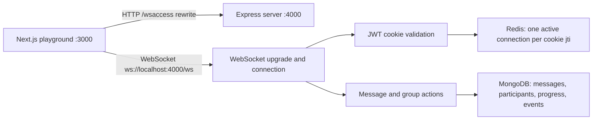

# Message Forwarder Experiment

A small chat application used to explore WebSocket messaging, persisted delivery, event tracking, and group invitations. The repository contains a Next.js playground and a Node.js WebSocket server.

## How the application is orchestrated



The frontend asks the local test server for an access cookie through `/wsaccess`, then opens `ws://localhost:4000/ws`. The HTTP call is proxied by [frontend/next.config.ts](frontend/next.config.ts). The test launcher creates a local RSA key pair and a bootstrap token for the server and test browser; the browser does not receive private-key environment variables.

On startup, [server/app/index.ts](server/app/index.ts) loads Express middleware and the cookie route, connects Redis, creates an HTTP or HTTPS server, and registers the WebSocket upgrade handler. The upgrade handler verifies the short-lived `ws_access` JWT and locks its `jti` in Redis. The lock is renewed while the socket is alive and released when it closes. After upgrade, the connection restores message event partitions and persisted messages.

The WebSocket channel registry dispatches `chat`, `message_event`, and `group` actions. Message actions interpret recipient prefixes as follows:

| Prefix | Destination | Storage |
| --- | --- | --- |
| `#` | Direct user | `primary_messages` |
| `@` | Room | `room_messages` |
| `$` | Group | `group_messages` |

Each destination has an action layer responsible for authorization and persistence; handlers do not select Mongo collections directly. Direct messages can be forwarded live or restored after reconnect. Rooms and groups are persisted for later retrieval. Group messages report `sending`/`sent` status only: successful socket writes advance internal invite or delivery coverage but do not emit delivered or read receipts.

Group membership, roles, and invite progress are coordinated by group actions and Mongo repositories. Pending invites store a timestamp `offset` and delivery `coverage` in `user_progression`. On acceptance, the server captures the current latest group message ID, sends any uncovered messages through that boundary, advances the active per-group cursor, and removes the invite only after those sends succeed. Invites expire after 64 days.

## Local development

The combined playground launcher loads the root `.test.env`, starts the backend on port 4000 and the frontend on port 3000, and creates a local 24-hour bootstrap token:

```sh
node frontend/scripts/start.test.server.mjs
```

Open `http://localhost:3000` in two browser sessions and connect as different user IDs. The test stack requires the configured MongoDB and Redis services. For a frontend-only session, `cd frontend && npm run dev`; for the backend’s standalone entry point, use the root `npm run serve` script with its required environment configured.

Run the Vitest suite from the repository root with `npm test`. Integration tests use `.test.env` and need the configured services available.

## Project map

- [frontend/README.md](frontend/README.md) — playground, WebSocket client, and frontend setup.
- [server/README.md](server/README.md) — server module map and further documentation.
- [server/docs/README.md](server/docs/README.md) — server design notes.
- [server/test/README.md](server/test/README.md) — test areas and service requirements.
